# 学生宿舍管理系统

> 🎓 **计算机毕业设计 · 学生宿舍管理系统**
>
> 本仓库只放**项目介绍 + 运行截图**（截图是站点带水印的原图，存在仓库 `images/` 里）。
>
> 👉 **完整可运行源码 / 数据库脚本 / 部署文档：[点我获取](https://geekcode.top/archives/%E5%AD%A6%E7%94%9F%E5%AE%BF%E8%88%8D%E7%AE%A1%E7%90%86%E7%B3%BB%E7%BB%9F?utm_source=github)**
>
> 💬 咨询微信：**ir9372**　|　🌐 更多项目：[极客代码 geekcode.top](https://geekcode.top/?utm_source=github)
>
> 📌 项目详情页：<https://geekcode.top/archives/%E5%AD%A6%E7%94%9F%E5%AE%BF%E8%88%8D%E7%AE%A1%E7%90%86%E7%B3%BB%E7%BB%9F?utm_source=github>

<table><td width="230" align="center"> <b>扫码加微信 ir9372</b></td><td valign="middle">📦 源码 = 项目介绍 + 全部运行截图 + 数据库 + 部署文档 👉 点上方任意截图，直接跳到 <b>极客代码 geekcode.top</b> 详情页</td></table>

---

<h1>学生宿舍管理系统</h1>
<h2>项目概述</h2>

本项目为“学生宿舍管理系统”，旨在通过数字化手段优化高校宿舍的日常管理流程，提升宿管工作效率及学生住宿体验。系统采用前后端分离架构，核心聚焦于后台管理功能，涵盖学生信息管理、宿舍楼栋分配、考勤记录与统计、学分奖惩机制以及报告提交等关键业务模块。适用人群主要为学校宿管人员、行政管理人员及系统管理员。技术架构基于 Spring Boot 后端框架，结合 MyBatis-Plus 进行数据持久化操作，并使用 Shiro 实现权限控制，确保系统的安全性与稳定性。该系统解决了传统纸质或分散式管理中数据滞后、统计困难及权限混乱的问题，实现了宿舍管理的规范化与智能化。

<h2>技术架构</h2>
<h3>前后端架构</h3>

本项目采用 Vue-Integrated（Vue 集成）模式的前后端分离架构。前端负责用户界面展示与交互逻辑，通过 HTTP 请求与后端 API 进行数据通信；后端提供 RESTful 风格的接口服务，处理业务逻辑、数据验证及数据库操作。由于项目无独立前台路由和导航菜单，所有用户交互均集中在后台管理端完成，体现了其作为内部管理系统的设计定位。

<h3>核心技术选型理由</h3>
<ol>
<li><strong>Spring Boot</strong>：作为后端基础框架，利用其自动配置特性简化开发流程，快速构建稳定的 Web 应用服务。</li>
<li><strong>MyBatis-Plus</strong>：在 MyBatis 基础上增强 CRUD 操作能力，减少重复代码编写，提高数据访问层的开发效率与维护性。</li>
<li><strong>Shiro</strong>：用于实现细粒度的权限管理与身份认证，确保不同角色只能访问授权范围内的资源，保障数据安全。</li>
<li><strong>MySQL</strong>：作为关系型数据库存储学生信息、宿舍数据、考勤记录及学分变动日志，支持高并发读写需求。</li>
<li><strong>Vue.js</strong>：前端框架提供响应式数据绑定组件化开发能力，提升页面渲染性能与用户体验。</li>
</ol>
<h3>数据库设计要点</h3>

数据库设计围绕核心实体展开，主要包括：

<ul>
<li><strong>用户与权限表</strong>：存储管理员、宿管等角色信息及对应的权限标识。</li>
<li><strong>基础信息表</strong>：包含班级信息 (<code>Banji</code>)、宿舍楼栋信息 (<code>Susheloudong</code>)、学生基本信息 (<code>Xuesheng</code>)。</li>
<li><strong>业务逻辑表</strong>：</li>
<li><code>Chuqinlvpingjia</code> (出勤率评价)：关联学生与考勤统计数据。</li>
<li><code>Jianxuefenchufa</code> / <code>Jiaxuefenjiangli</code> (减/加学分处罚/奖励)：记录学分变动的详细流水。</li>
<li><code>Tijiaobaogao</code> (提交报告)：存储缺勤或异常情况上报内容。</li>
<li><code>Xueshengxuefen</code> (学生学分)：汇总每位学生的当前学分状态。</li>
</ul>
<h2>功能模块</h2>

本项目仅包含后台管理端功能，无面向普通学生的前台门户。各模块具体功能如下：

<h3>1. 基础信息管理模块</h3>
<ul>
<li><strong>班级管理 (<code>/banji</code>)</strong>：维护学校班级档案，包括班级名称、所属年级等信息，便于按班级维度进行数据统计。</li>
<li><strong>宿舍楼栋管理 (<code>/susheloudong</code>)</strong>：录入和管理宿舍楼号、楼层及房间分布情况，为床位分配提供基础数据支撑。</li>
<li><strong>学生信息管理 (<code>/xuesheng</code>)</strong>：对学生基本资料进行增删改查，包括姓名、学号、性别、联系方式及所属班级和宿舍。</li>
<li><strong>宿管人员管理 (<code>/suguan</code>)</strong>：管理负责特定区域或楼栋的宿管人员信息，明确责任范围。</li>
</ul>
<h3>2. 考勤与评价模块</h3>
<ul>
<li><strong>学生考勤 (<code>/xueshengkaoqin</code>)</strong>：记录每日或每时段的查寝结果，标记学生是否在寝、迟到或缺勤。</li>
<li><strong>出勤排行榜 (<code>/chuqinpaixingbang</code>)</strong>：根据考勤数据生成排名列表，直观展示个人、班级或宿舍的出勤表现。</li>
<li><strong>出勤率评价 (<code>/chuqinlvpingjia</code>)</strong>：对长期出勤情况进行量化评分，形成周期性评价报告。</li>
</ul>
<h3>3. 学分与奖惩模块</h3>
<ul>
<li><strong>学生学分 (<code>/xueshengxuefen</code>)</strong>：实时查看每位学生的综合学分状况，作为评优评先的依据。</li>
<li><strong>加学分奖励 (<code>/jiaxuefenjiangli</code>)</strong>：针对表现优异（如全勤、卫生标兵）的学生或宿舍进行学分加分操作。</li>
<li><strong>减学分处罚 (<code>/jianxuefenchufa</code>)</strong>：针对违规违纪行为（如晚归、脏乱差）执行学分扣分处理。</li>
</ul>
<h3>4. 预警与报告模块</h3>
<ul>
<li><strong>警告提醒 (<code>/jinggaotixing</code>)</strong>：当学生出现多次缺勤或严重违规时，系统自动生成或手动触发警告通知。</li>
<li><strong>提交报告 (<code>/tijiaobaogao</code>)</strong>：宿管人员可上传特殊情况的书面报告或图片证据，形成完整的管理闭环。</li>
<li><strong>消除缺勤报告 (<code>/xiaochuqueqinbaogao</code>)</strong>：对于因请假等原因导致的非实质性缺勤，提供审核与消除记录的入口，修正考勤数据。</li>
</ul>
<h2>用户角色与权限</h2>

根据截图所示的登录页及后台路由结构，本系统主要服务于内部管理场景。虽然未明确列出多角色细分界面，但基于 Shiro 框架及典型管理系统设计，推断存在以下角色权限划分：

<h3>1. 系统管理员 (Admin)</h3>
<ul>
<li><strong>权限范围</strong>：拥有最高权限，可访问所有后台路由模块。</li>
<li><strong>核心职责</strong>：</li>
<li>维护基础数据（班级、宿舍楼栋、学生档案）。</li>
<li>配置系统参数及用户账号。</li>
<li>审核并执行所有的学分奖惩操作。</li>
<li>查看全局统计报表（出勤排行榜、整体出勤率评价）。</li>
</ul>
<h3>2. 宿管人员 (Dormitory Manager)</h3>
<ul>
<li><strong>权限范围</strong>：通常受限于所管辖的楼栋或区域，具体取决于系统设计时的数据隔离策略。</li>
<li><strong>核心职责</strong>：</li>
<li>执行日常考勤记录 (<code>/xueshengkaoqin</code>)。</li>
<li>提交异常情况报告 (<code>/tijiaobaogao</code>)。</li>
<li>发起减学分处罚申请 (<code>/jianxuefenchufa</code>)。</li>
<li>查看所辖区域的出勤排行榜 (<code>/chuqinpaixingbang</code>)。</li>
</ul>

<em>(注：根据现有源码上下文，未提供具体的角色区分界面截图，以上角色划分基于通用管理系统逻辑推导，实际部署中可通过 Shiro 配置进一步细化按钮级或数据级权限。)</em>

<h2>项目特色与创新点</h2>
<ol>
<li><strong>学分联动管理机制</strong>：将宿舍考勤直接与学生学分挂钩，通过“加学分奖励”和“减学分处罚”两个独立模块，建立了正向激励与负向约束相结合的管理体系，增强了制度执行力。</li>
<li><strong>闭环式异常处理流程</strong>：设计了从“提交报告”到“警告提醒”再到“消除缺勤报告”的完整链路。特别是“消除缺勤报告”功能，允许对误报或有合理请假手续的记录进行修正，保证了数据的准确性和公平性。</li>
<li><strong>多维度的可视化统计</strong>：通过“出勤排行榜”和“出勤率评价”模块，不仅提供原始记录，还进行了二次加工与分析，帮助管理者快速识别问题宿舍或重点关注学生群体。</li>
<li><strong>轻量级高效架构</strong>：采用 Spring Boot + MyBatis-Plus + Shiro 的经典组合，去除了复杂的前台用户交互，专注于后台管理效能，降低了系统复杂度，提升了运维便捷性和响应速度。</li>
</ol>
<h2>部署环境</h2>

为确保系统正常运行，需准备以下软硬件环境：

<h3>1. 软件环境</h3>
<ul>
<li><strong>操作系统</strong>：Windows 10/11, Linux (CentOS 7+, Ubuntu 18.04+), macOS。</li>
<li><strong>Java 运行环境</strong>：JDK 1.8 及以上版本。</li>
<li><strong>数据库</strong>：MySQL 5.7 或 MySQL 8.0（需初始化相关表结构）。</li>
<li><strong>Web 服务器</strong>：内置 Tomcat (由 Spring Boot 提供)，生产环境建议配合 Nginx 反向代理。</li>
<li><strong>Node.js</strong>：v14.x 或 v16.x（用于前端 Vue 项目的编译打包）。</li>
<li><strong>包管理器</strong>：Maven (用于后端依赖管理)，npm/yarn (用于前端依赖管理)。</li>
</ul>
<h3>2. 硬件推荐</h3>
<ul>
<li><strong>CPU</strong>：Intel Core i5 或同等性能处理器以上。</li>
<li><strong>内存</strong>：至少 4GB RAM（建议 8GB 以流畅运行 IDE 和服务）。</li>
<li><strong>硬盘</strong>：剩余空间不少于 10GB SSD。</li>
</ul>
<h3>3. 启动步骤简述</h3>
<ol>
<li>安装 JDK 和 MySQL，创建数据库并导入 SQL 脚本。</li>
<li>修改后端配置文件 (<code>application.yml</code> 或 <code>properties</code>) 中的数据库连接地址、用户名和密码。</li>
<li>使用 Maven 命令编译打包后端项目 (<code>mvn clean package</code>)。</li>
<li>进入前端目录，安装依赖 (<code>npm install</code>) 并构建静态文件 (<code>npm run build</code>)。</li>
<li>运行后端 Jar 包，并将前端构建产物部署至 Web 服务器或直接放入后端静态资源目录。</li>
</ol>
<h2>五、技术特性</h2>
<ul>
<li>前后端集成部署，前端资源打包至后端 static 目录</li>
<li>使用 MyBatis-Plus 简化数据访问层开发</li>
<li>集成 Shiro 权限框架实现角色权限控制</li>
</ul>
<h2>六、功能模块截图</h2>
<h3>后台管理端</h3>
<h4>后台-班级</h4>

<a href="https://geekcode.top/archives/%E5%AD%A6%E7%94%9F%E5%AE%BF%E8%88%8D%E7%AE%A1%E7%90%86%E7%B3%BB%E7%BB%9F?utm_source=github" title="查看完整源码">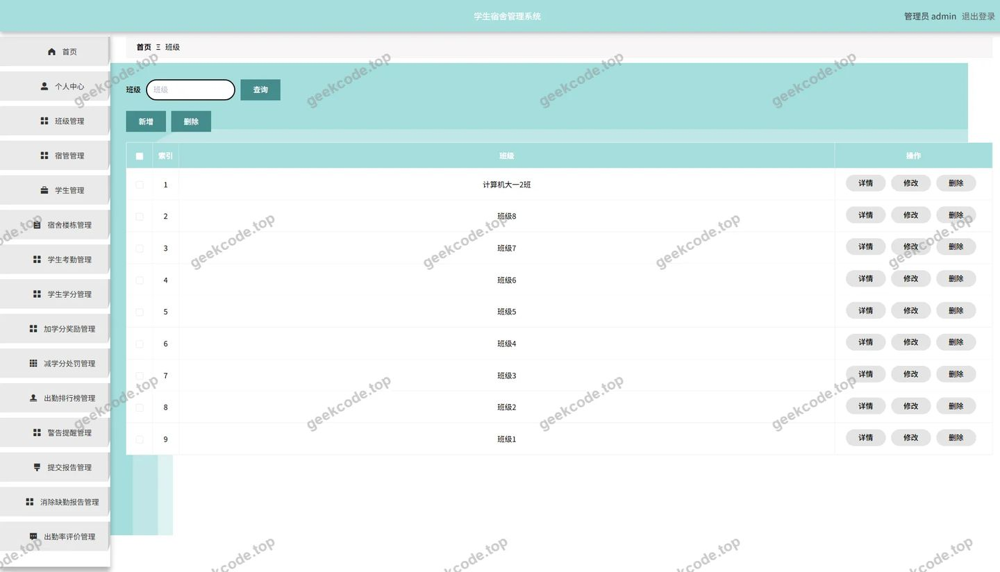</a>

<h4>后台-出勤率评价</h4>

<a href="https://geekcode.top/archives/%E5%AD%A6%E7%94%9F%E5%AE%BF%E8%88%8D%E7%AE%A1%E7%90%86%E7%B3%BB%E7%BB%9F?utm_source=github" title="查看完整源码">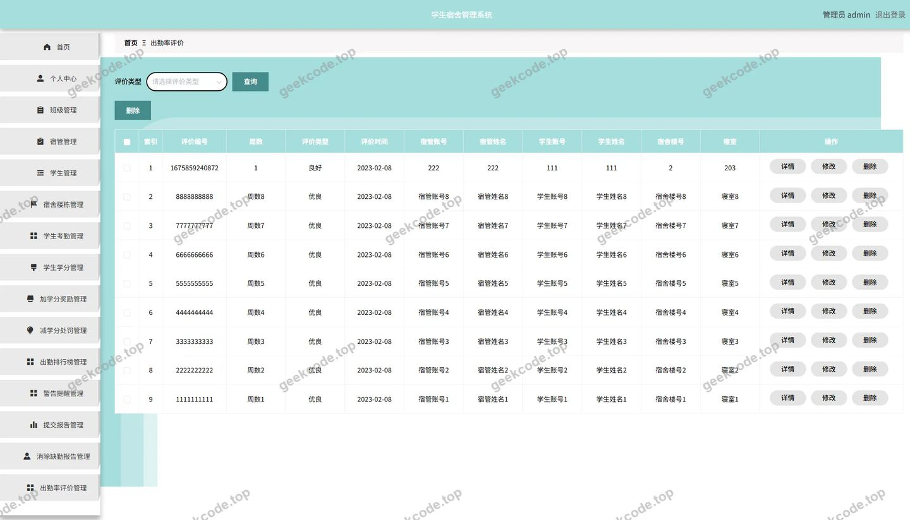</a>

<h4>后台-出勤排行榜</h4>

<a href="https://geekcode.top/archives/%E5%AD%A6%E7%94%9F%E5%AE%BF%E8%88%8D%E7%AE%A1%E7%90%86%E7%B3%BB%E7%BB%9F?utm_source=github" title="查看完整源码">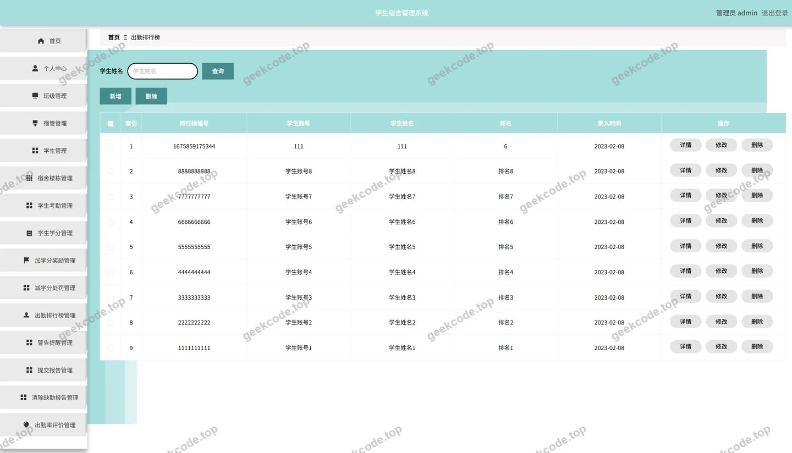</a>

<h4>后台首页</h4>

<a href="https://geekcode.top/archives/%E5%AD%A6%E7%94%9F%E5%AE%BF%E8%88%8D%E7%AE%A1%E7%90%86%E7%B3%BB%E7%BB%9F?utm_source=github" title="查看完整源码">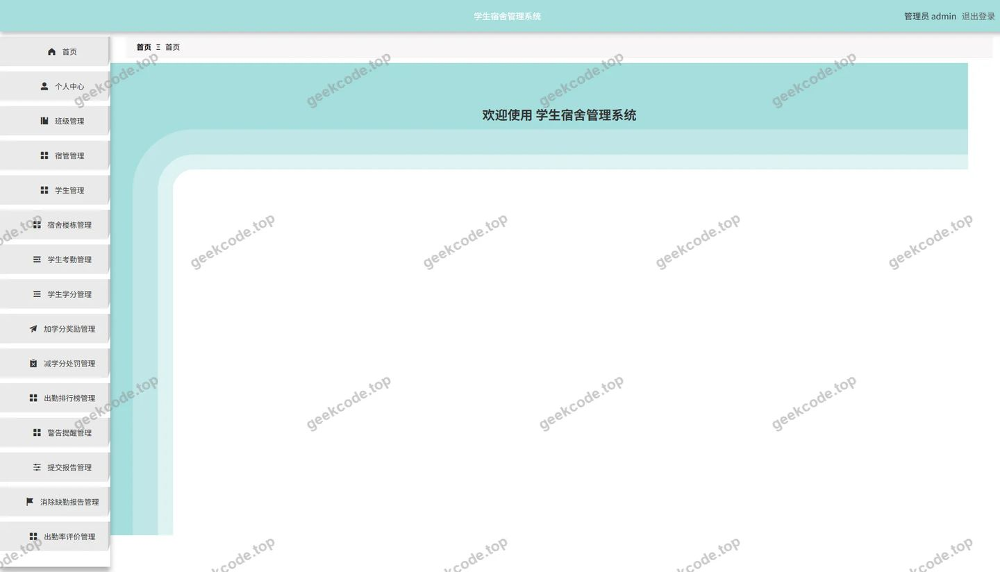</a>

<h4>后台-减学分处罚</h4>

<a href="https://geekcode.top/archives/%E5%AD%A6%E7%94%9F%E5%AE%BF%E8%88%8D%E7%AE%A1%E7%90%86%E7%B3%BB%E7%BB%9F?utm_source=github" title="查看完整源码">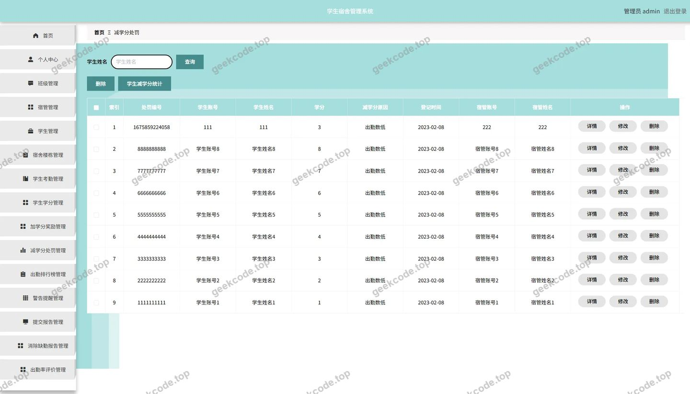</a>

<h4>后台-加学分奖励</h4>

<h4>后台-警告提醒</h4>

<a href="https://geekcode.top/archives/%E5%AD%A6%E7%94%9F%E5%AE%BF%E8%88%8D%E7%AE%A1%E7%90%86%E7%B3%BB%E7%BB%9F?utm_source=github" title="查看完整源码">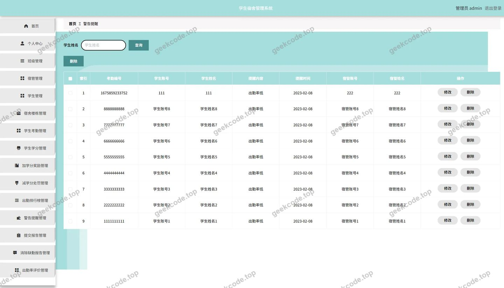</a>

<h4>后台-登录</h4>

<a href="https://geekcode.top/archives/%E5%AD%A6%E7%94%9F%E5%AE%BF%E8%88%8D%E7%AE%A1%E7%90%86%E7%B3%BB%E7%BB%9F?utm_source=github" title="查看完整源码">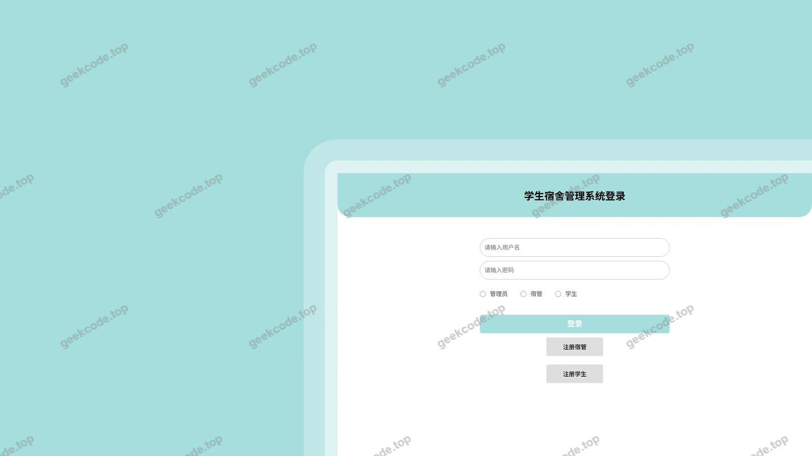</a>

<h4>后台-宿管</h4>

<a href="https://geekcode.top/archives/%E5%AD%A6%E7%94%9F%E5%AE%BF%E8%88%8D%E7%AE%A1%E7%90%86%E7%B3%BB%E7%BB%9F?utm_source=github" title="查看完整源码">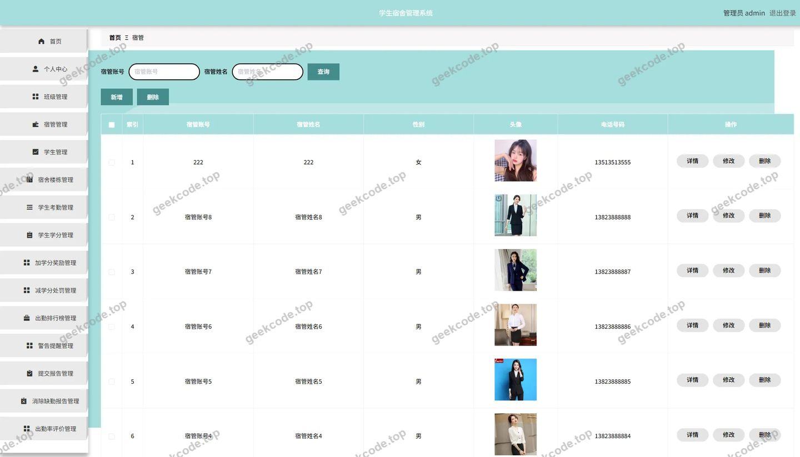</a>

<h4>后台-宿舍楼栋</h4>

<a href="https://geekcode.top/archives/%E5%AD%A6%E7%94%9F%E5%AE%BF%E8%88%8D%E7%AE%A1%E7%90%86%E7%B3%BB%E7%BB%9F?utm_source=github" title="查看完整源码">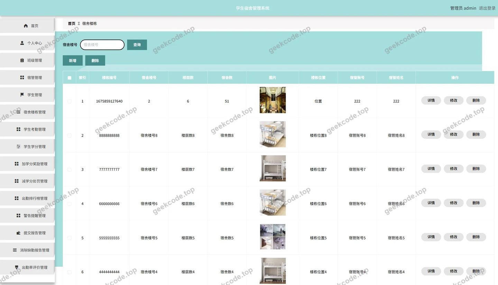</a>

<h4>后台-提交报告</h4>

<a href="https://geekcode.top/archives/%E5%AD%A6%E7%94%9F%E5%AE%BF%E8%88%8D%E7%AE%A1%E7%90%86%E7%B3%BB%E7%BB%9F?utm_source=github" title="查看完整源码">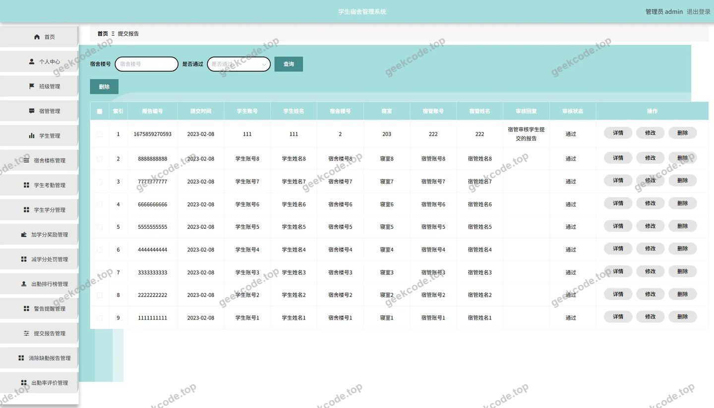</a>

<h4>后台-消除缺勤报告</h4>

<a href="https://geekcode.top/archives/%E5%AD%A6%E7%94%9F%E5%AE%BF%E8%88%8D%E7%AE%A1%E7%90%86%E7%B3%BB%E7%BB%9F?utm_source=github" title="查看完整源码">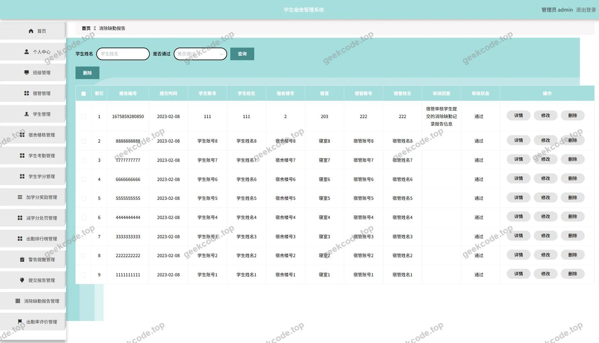</a>

<h4>后台-学生</h4>

<a href="https://geekcode.top/archives/%E5%AD%A6%E7%94%9F%E5%AE%BF%E8%88%8D%E7%AE%A1%E7%90%86%E7%B3%BB%E7%BB%9F?utm_source=github" title="查看完整源码">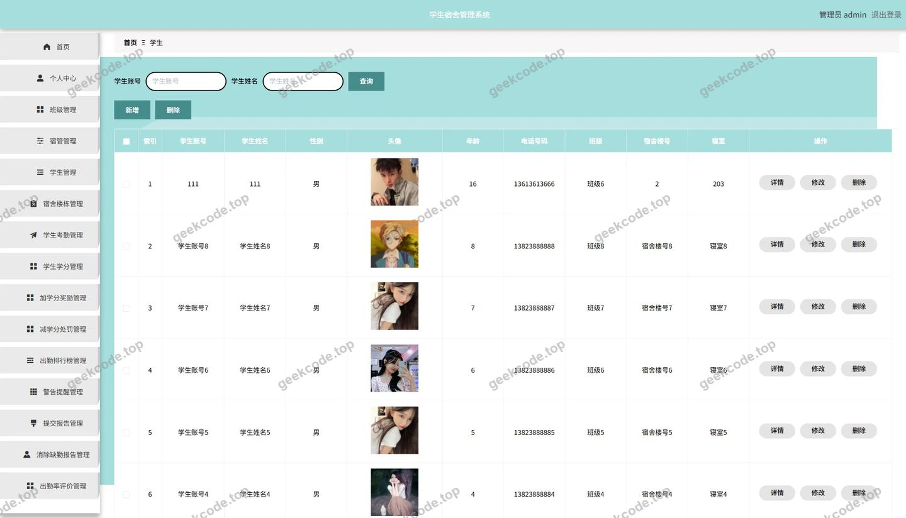</a>

<h4>后台-学生考勤</h4>

<a href="https://geekcode.top/archives/%E5%AD%A6%E7%94%9F%E5%AE%BF%E8%88%8D%E7%AE%A1%E7%90%86%E7%B3%BB%E7%BB%9F?utm_source=github" title="查看完整源码">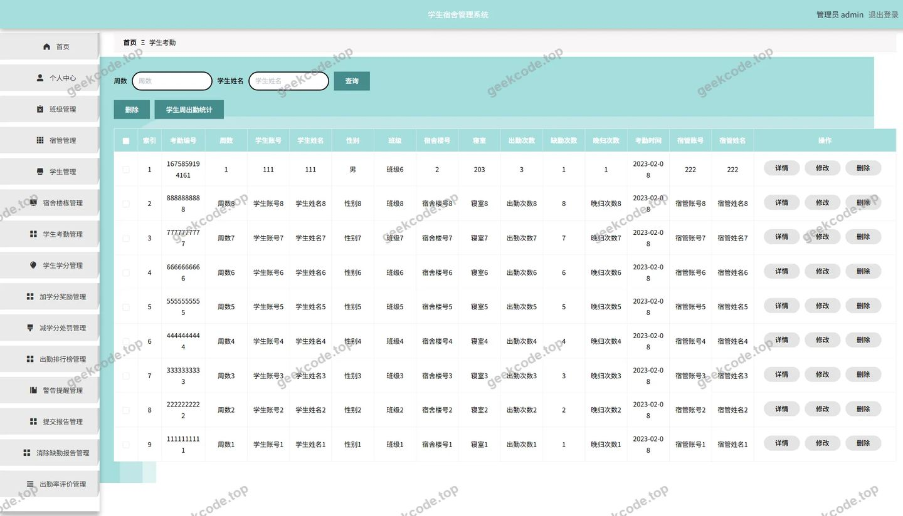</a>

<h4>后台-学生学分</h4>

<a href="https://geekcode.top/archives/%E5%AD%A6%E7%94%9F%E5%AE%BF%E8%88%8D%E7%AE%A1%E7%90%86%E7%B3%BB%E7%BB%9F?utm_source=github" title="查看完整源码">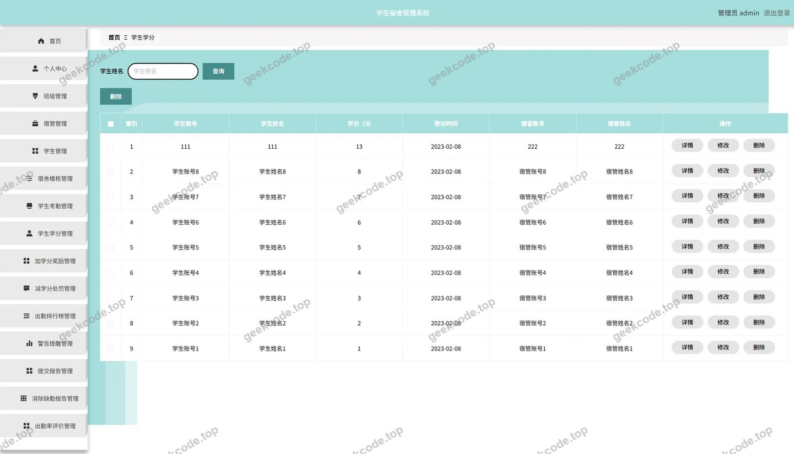</a>

---

## 获取完整源码

| 项目 | 说明 |
| --- | --- |
| 项目名 | 学生宿舍管理系统 |
| 运行截图 | 本文 15 张（站点带水印原图，仓库 `images/` 目录） |
| 完整源码 | [https://geekcode.top/archives/%E5%AD%A6%E7%94%9F%E5%AE%BF%E8%88%8D%E7%AE%A1%E7%90%86%E7%B3%BB%E7%BB%9F?utm_source=github](https://geekcode.top/archives/%E5%AD%A6%E7%94%9F%E5%AE%BF%E8%88%8D%E7%AE%A1%E7%90%86%E7%B3%BB%E7%BB%9F?utm_source=github) |
| 咨询微信 | **ir9372**（备注：jingpin-yuanma） |
| 更多项目 | [极客代码 geekcode.top](https://geekcode.top/?utm_source=github) |

> 需要源码、部署、改配置、跑不起来等问题，加微信 ir9372 沟通，说明项目名即可。
